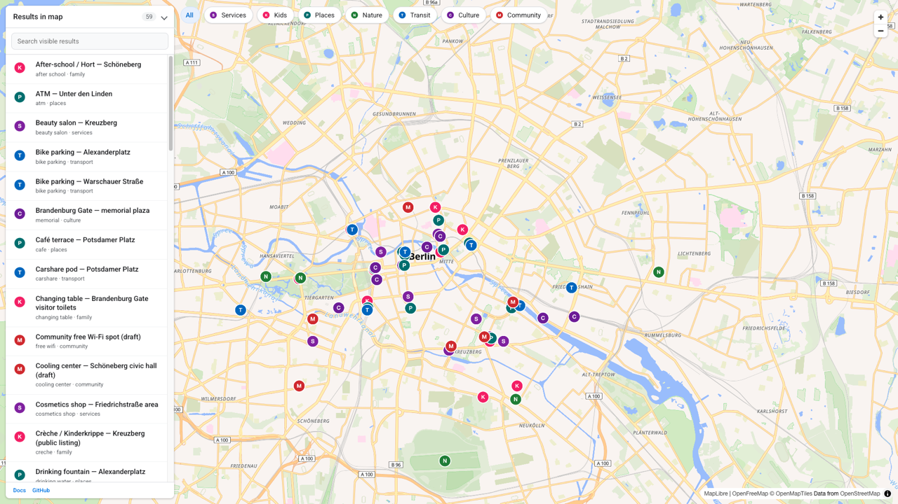

# World Map Open Source



Collaborative, **git-native GeoJSON overlays** on top of **OpenFreeMap** + **MapLibre**.

We do **not** rebuild OSM or run a tile farm. The basemap is free; curated layers are the product.

**Stack rule:** no builds — edit GeoJSON → validate → PR → visible. Static demo only.

> Screenshot: [`docs/assets/demo-preview.png`](docs/assets/demo-preview.png) · also used as [`og-preview.png`](docs/assets/og-preview.png) for social / Pages cards.

## Quick start (demo)

Serve the **repo root** so overlay GeoJSON paths resolve:

```bash
python3 -m http.server 5173
# Demo:   http://localhost:5173/apps/demo/
# Embed:  http://localhost:5173/apps/embed/
# Docs:   http://localhost:5173/apps/docs/
# Manifest: http://localhost:5173/overlays/manifest.json
```

Demo UX (Berlin): layer chips, left results list (expand/collapse), search among **visible** pins, Directions deep-links, list updates when the map moves. Flat 2D map only. Overlays load from [`overlays/manifest.json`](overlays/manifest.json) in parallel after the basemap.

**Docs (EN):** [apps/docs/](apps/docs/) — overview, embed for agents, and how to contribute. Sample city: **Berlin**.

## MVP overlay categories

**Focus:** services useful to women + spaces for children.

| Folder | Theme | Review |
|--------|--------|--------|
| `overlays/services/` | Salon, tailor, laundry, midwife, physio, … | open |
| `overlays/family/` | Playgrounds, creche/Kita, changing/nursing, … | open |
| `overlays/places/` | Pharmacy, cafés, toilets, libraries, … | open |
| `overlays/nature/` | Viewpoints, trailheads, outdoors | open |
| `overlays/transport/` | Bike parking, EV, micromobility | open |
| `overlays/culture/` | Murals, venues, memorials | open |
| `overlays/community/` | Mutual aid, women support (public orgs) | **human review** |

Each layer has an `icon` + `color` in [`schemas/taxonomy.json`](schemas/taxonomy.json) and an SVG under [`assets/icons/`](assets/icons/).

Test city: **Berlin** → `overlays/<category>/berlin.geojson`.  
MCP (optional): [`packages/mcp/`](packages/mcp/).  
Full plan: **[docs/PLAN.md](docs/PLAN.md)**

## Contribute

See [CONTRIBUTING.md](CONTRIBUTING.md).

```bash
npm install --no-save ajv@8 ajv-formats@3
node scripts/validate-overlays.mjs
```

## Maintainer — looking for collaborators

**Stefan Petrovici** — software engineer (Romania). Builds web products end-to-end; this repo is an open, git-native map layer for women- and kids-focused curated pins.

- GitHub: [github.com/petrovicistefan](https://github.com/petrovicistefan)
- Site: [petrovicistefan.ro](https://petrovicistefan.ro)
- Bio: turning complex product ideas into scalable web apps

**Open to:** side projects, open-source collaboration, and teammates who want to ship map/agent tooling, product UI, or curated overlay data with me. Open an issue, a PR, or ping me on GitHub if you want to build together.

## Repo layout

```
overlays/     curated GeoJSON by category (Berlin MVP)
assets/icons/ layer icons (SVG)
schemas/      taxonomy.json + overlay.schema.json
overlays/manifest.json  stable URL index for agents / embeds
apps/demo/    static MapLibre demo (chips + results list)
apps/embed/   drop-in map for third-party demos
apps/docs/    documentation UI
packages/sdk/ plain ESM validate helpers
packages/mcp/ optional file-backed MCP server
scripts/      validate-overlays.mjs (CI)
docs/PLAN.md  product plan
```

`.cursor/` is local-only (gitignored).

## License

Overlay data default: **ODbL-1.0** (see feature `license` property).  
Code: TBD (propose MIT when publishing).
